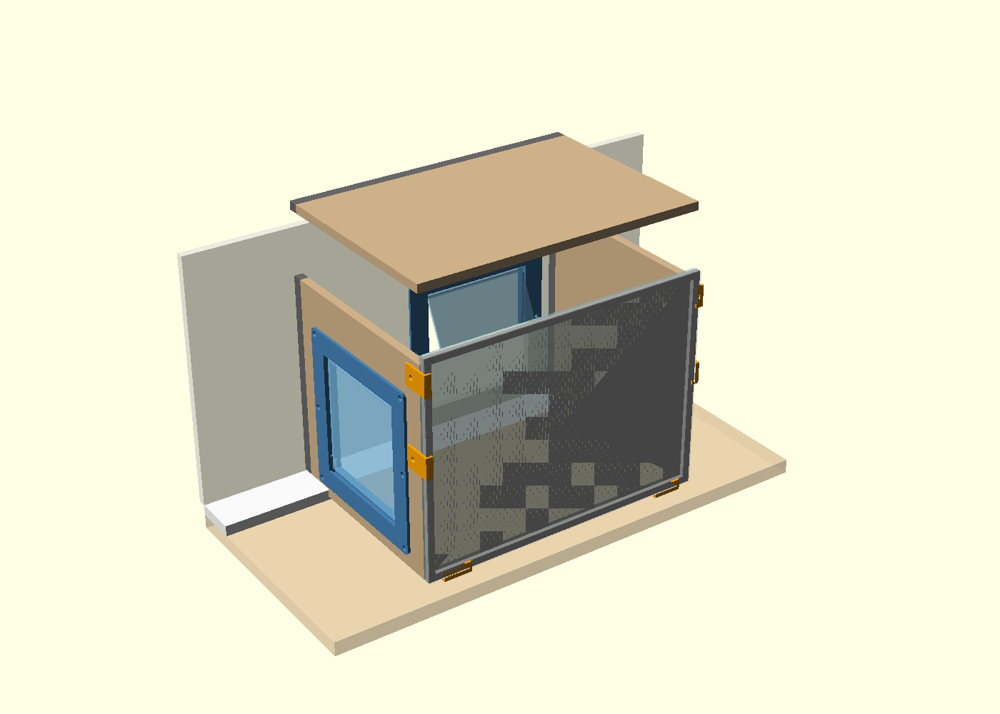
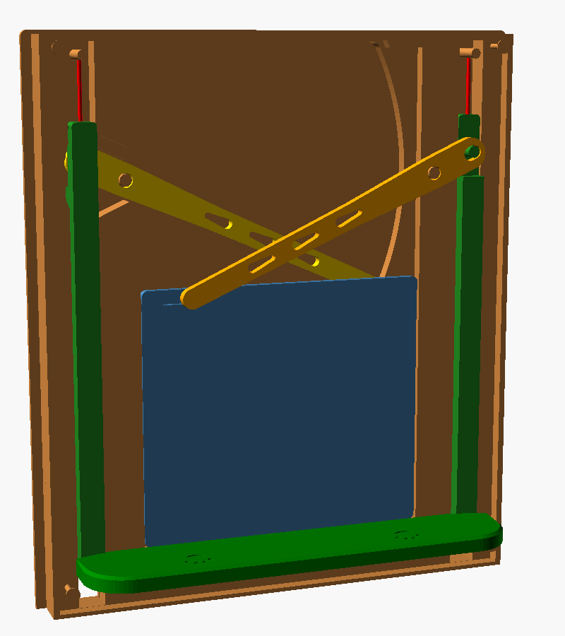
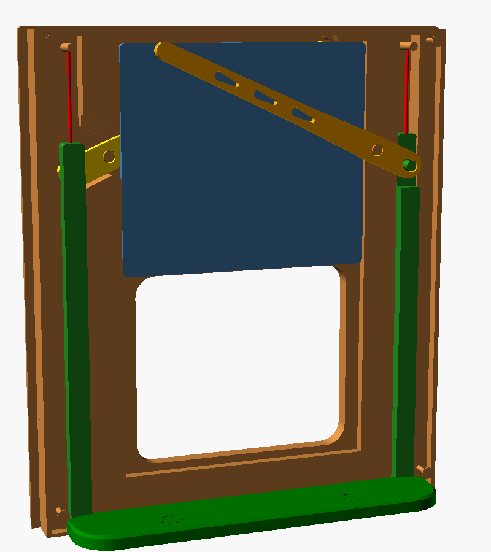
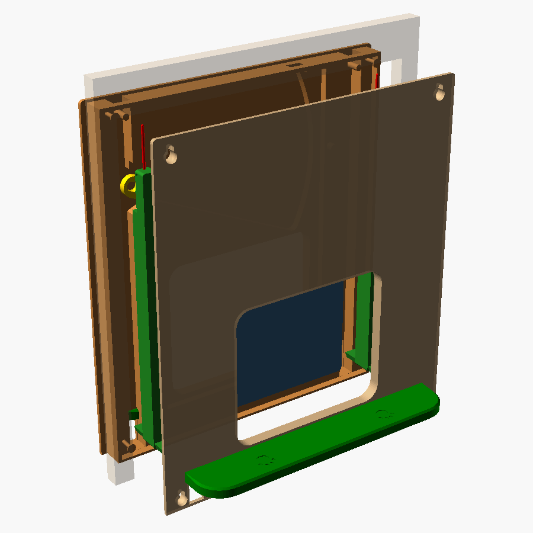
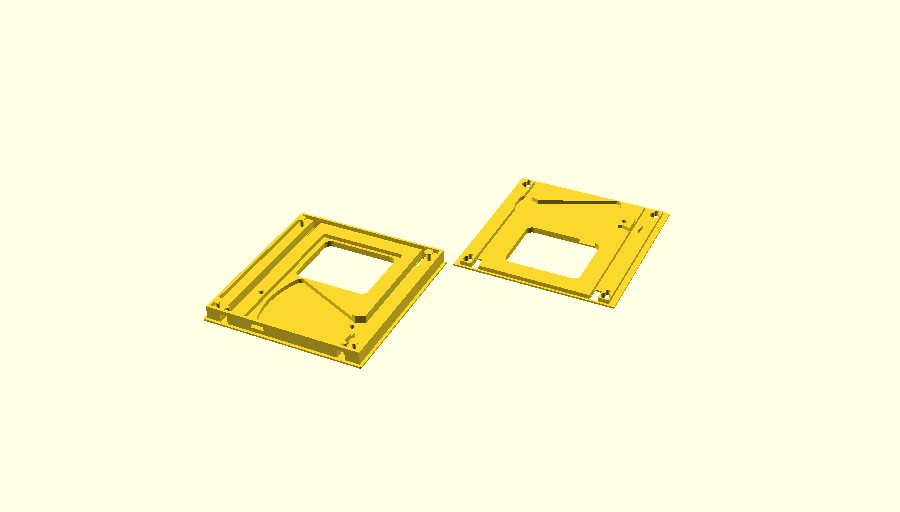
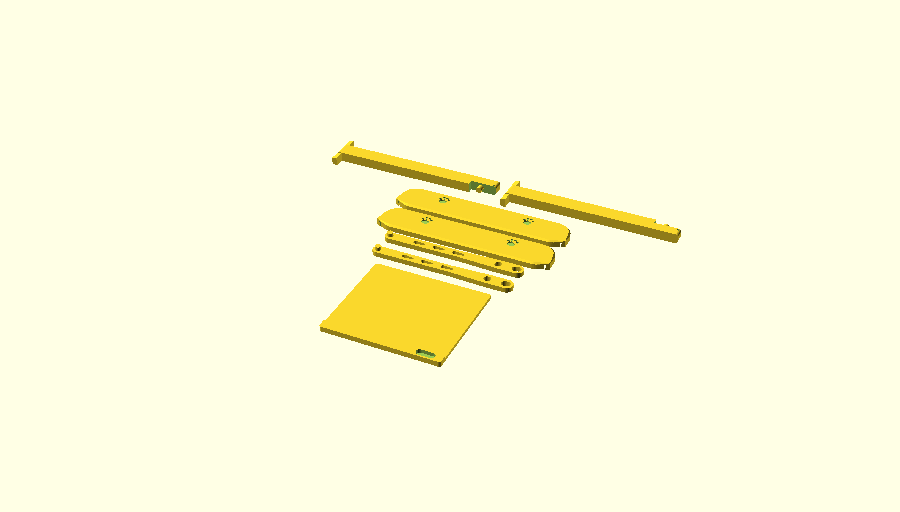

# Chatière d'hiver — concept A : « SAS » (vestibule à deux volets)



## 1. Idée

On construit une **petite boîte posée sur l'appui intérieur**, collée contre la fenêtre, devant le
panneau gris actuel (celui du trou hexagonal bouché par la serviette verte).

* **Volet 1 (extérieur)** : dans le panneau gris de la fenêtre (le trou hexagonal est agrandi en rectangle).
* **Volet 2 (intérieur)** : dans la **paroi gauche** de la boîte, donc à 90° du volet 1.
* **Façade** : la vitre 411 × 309 **non coupée**, posée en paysage. On voit le chat et le jour entre.
* **Couvercle amovible** : il suffit de le soulever pour nettoyer l'intérieur, y compris la face arrière de la vitre.

L'air froid doit franchir **deux barrières en série** et faire un virage. Le vent ne peut plus
ouvrir un volet qui donne directement dans la pièce. Le chat ne pousse jamais les deux volets en même temps
(sauf s'il s'arrête à cheval dessus).

## 2. Croquis (cotes en mm)

Vue de dessus (fenêtre en haut, pièce en bas) :

```
              fenêtre / panneau gris  (volet 1 au droit du trou)
   ═══════════════════════════════╦════[ V1 ]════╦═══════════
                  mousse 15 →     ║░░░░░░░░░░░░░░║  (rebord PVC 60 sous l'arrière des côtés)
                                  ║              ║
                  ┌─[bride]       ║   intérieur  ║
   pièce  ◄── V2 ═╡ 216 large     ║ 387 × 275    ║
   (sortie)       └─              ║  h 285       ║
                                  ║              ║
                                  ╚══════════════╝  ← côtés et couvercle 275 de profondeur
                                  ▓▓▓▓▓▓▓▓▓▓▓▓▓▓▓▓  ← vitre 411 (+ polycarbonate optionnel)
                                  ← 411 hors-tout →       bord avant de l'appui
```

Vue de face (côté pièce) :

```
     ┌───────────────────────────────────────┐ ▲  ← couvercle 12 (amovible)
  ┌──┤                                       ├┐│
  │V2│          vitre 411 × 309              ││ 309   jeu libre sous l'embrasure : 368 − 314 = 54
  │  │          (paysage, non coupée)        ││ │
  └──┤                                       ├┘│
     └─[sabot]───────────────────────[sabot]─┘ ▼  ← plancher 12
  ═══════════ patins 5 ════════════════════════   appui en bois
```

Coupe de côté :

```
      fenêtre                      vitre
        ║ V1 ─┐  ┌──────── couvercle ────────┐
        ║     │  │                           │▌
   mousse 15 ─►  │     intérieur h 285       │▌ 309
        ║        │                           │▌
 rebord ▄▄▄▄▄▄▄  └───────── plancher 230 ────┘▌
 PVC 60 × 15 ════════════ appui 305 ════════════
               ◄────────── 275 ─────────────►◄ 12 (vitre + lame d'air + PC)
```

### Cotes principales

| Élément | Valeur |
|---|---|
| Hors-tout caisson | **411 L × 287 P × 314 H** (avec patins) |
| Intérieur | 387 × 275 × 285 |
| Jeu sous l'embrasure (368) | 54 mm → on soulève le couvercle sans tout démonter |
| Profondeur occupée | 275 + 15 de mousse + 12 de façade ≈ **302 sur 305** |
| Ouverture de passage (chaque volet) | 160 × 170 (chatière « grand chat » ≈ 155 × 165) |
| Cadre de volet imprimé | 216 × 226 × 18 (≤ 260) |
| Trou à scier pour le collier | 177 × 187 |
| Volet 2 dans la paroi gauche | centre à 138 de l'avant, bas du passage à 35 au-dessus du plancher |

**À mesurer avant de couper** (paramètres dans le `.scad`) : épaisseur de la vitre (`verre_e`),
profondeur et hauteur du rebord PVC blanc (`rebord_prof`, `rebord_h`), épaisseur du panneau gris
(→ `collier_long` du volet 1), taille du trou hexagonal, largeur disponible dans l'embrasure
(≥ 420 mm pour la boîte calée contre le mur de droite, + ≈ 200 mm libres à gauche pour la sortie du chat).

## 3. La vitre : sans la couper

* Posée en **paysage** : 411 de large, 309 de haut. 309 + 5 de patins = 314 < 368. Elle couvre exactement
  le chant avant du plancher, des deux côtés et du couvercle : **le caisson est dimensionné sur la vitre**.
* Elle s'appuie sur un **ruban mousse adhésif 3 mm** collé sur les chants avant du bois.
* Le bas repose dans 2 **sabots** imprimés : la semelle se glisse sous le plancher (dans l'épaisseur des patins)
  et se visse par dessous, avec une lèvre avant de 12 mm.
* Sur les côtés, 4 **pinces** imprimées (2 par côté, à 150 et 260 mm) vissées sur la face extérieure des côtés,
  avec une lèvre de 7 mm sur l'avant de la vitre.
* Le haut est simplement plaqué par la mousse du couvercle. On peut soulever le couvercle sans toucher la vitre.
* Pour nettoyer la vitre côté intérieur, on soulève le couvercle et on passe le bras. Pour la retirer,
  on enlève 4 vis.
* **Option « double vitrage maison »** (`double_vitrage = true`, recommandée si la vitre est simple) :
  feuille de polycarbonate 2 mm coupée au cutter à 411 × 309, collée devant la vitre avec un **ruban mousse
  double-face de 6 mm** sur le pourtour, ce qui crée une lame d'air presque étanche. Les pinces et les sabots
  sont calculés sur l'épaisseur totale (`pile` = 4 + 6 + 2 = 12 mm).
  **Si la vitre est un thermos** (deux verres et un intercalaire, épaisseur 16 à 25 mm), mettre
  `verre_e` à sa valeur et `double_vitrage = false`, et **ne jamais la couper**.
* Les arêtes d'une vieille vitre coupent : les adoucir à la pierre à aiguiser ou au papier abrasif à l'eau
  (grain 120 puis 220), à 45°.

## 4. Volets

Les **deux volets sont identiques**. Seule la longueur du collier change selon l'épaisseur de la paroi
traversée.

* **Cadre** (`part="cadre"`) : bride de 4 mm + collier-tunnel de 8 mm qui traverse la paroi. Sur la face
  arrière de la bride, une **rainure de joint** en boucle reçoit un cordon de mousse/EPDM de 3-4 mm, pour que
  l'air ne passe pas entre le cadre et la paroi. On ferme de l'autre côté avec un **contre-cadre** de 3 mm,
  dont les vis sont décalées pour ne pas croiser celles de la bride.
* **Étanchéité du battant** : **coupe-froid à poils** (pile weatherstrip) insérés dans des rainures
  de 5,2 × 4 mm sur les deux montants, le seuil et le linteau. Ce dernier frotte sur le tube de charnière.
  Les poils permettent au battant de s'ouvrir **dans les deux sens**, ce qu'une feuillure ne permet pas.
  Hauteur de poil ≈ 8 mm (4 dans la rainure + 2,5 de jeu + 1,5 d'écrasement). Pour un dos de 6,9 mm,
  mettre `brosse_l = 7.3`.
* **Fermeture magnétique** : un aimant néodyme **6 × 3 mm** dans chaque montant (à 14 mm au-dessus
  du seuil) fait face à un aimant dans chaque coin bas du battant. Les aimants travaillent latéralement,
  à 2,5 mm de distance, et recentrent le battant au repos. Ils tiennent contre ~10 Pa de vent
  (≈ 0,3 N sur le battant) mais le chat les ouvre d'un coup de tête. Si c'est trop fort, remplacer
  les aimants du battant par des rondelles d'acier. **Vérifier la polarité avant de coller** (cyanoacrylate
  ou époxy) : il faut que les aimants s'attirent.
* **Battant** :
  * **Recommandé : polycarbonate 2 mm transparent** (le chat voit à travers). Le découper au cutter
    à 155 × ~165 et le monter avec `kit_charniere` (tube + fente, 3 vis M3) et 2 × `kit_aimant`.
    Il pèse environ 60 g et ne casse pas au froid.
  * Variante : `battant` entièrement imprimé (PETG 2,4 mm, avec nervures, ≈ 70 g), opaque.
* **Axe** : tige filetée **#8-32** (ou M4) coupée à ≈ 182 mm, avec un capuchon imprimé collé à chaque bout.
* **Matière** : **PETG** pour tout ce qui est près de la fenêtre. Le PLA devient cassant au froid et flue
  au soleil. Réglages : 4 périmètres, 25 % de remplissage, aucun support (le cadre s'imprime bride
  sur le plateau, le battant face plate dessous).

### Volet 1 dans le panneau gris

Le trou hexagonal est pointu en haut et en bas. Un battant rectangulaire qui s'ouvre vers l'extérieur
**accrocherait les pans inclinés**. Deux options :
1. **(recommandé)** Agrandir le trou en **rectangle 177 × 187** (scie sauteuse ou scie à guichet,
   après avoir percé les 4 coins), passer le collier au travers et visser la bride côté intérieur
   (dans la boîte), avec le contre-cadre côté extérieur. Régler `collier_long` = épaisseur du panneau + 2.
   Si le panneau est trop mince ou fragile, en refaire un en contreplaqué ou en PVC aux mêmes dimensions
   dans la coulisse.
2. Visser seulement la bride sur l'hexagone (il doit tenir dans la boucle du joint, 184 × 194). Le battant
   ne s'ouvre alors complètement que vers la boîte. Faire un essai avec un carton avant.

Si l'hexagone est plus grand que 184 × 194, augmenter `ouv_l`/`ouv_h` jusqu'à 204 au maximum
(la bride fait alors 260, la limite du plateau).

## 5. Liste de coupe — bois (contreplaqué 1/2 po ≈ 12 mm)

| Pièce | Qté | Dimensions (mm) | Remarque |
|---|---|---|---|
| Plancher | 1 | 411 × 230 | s'arrête devant le rebord PVC (275 + 15 − 60) |
| Côté droit | 1 | 275 (prof.) × 285 (haut.) | contre le mur de l'embrasure |
| Côté gauche | 1 | 275 × 285 | trou **177 × 187** : de 49,5 à 226,5 depuis l'avant, de 26,5 à 213,5 depuis le bas |
| Couvercle | 1 | 411 × 275 | posé sur les côtés |
| Tasseaux sous le couvercle | 2 | 12 × 20 × 250 | collés juste à l'intérieur des côtés pour centrer le couvercle |

Tout tient dans **un panneau de 2 × 4 pi**. Les côtés se posent **sur** le plancher (collés et vissés
avec des vis #6 × 1-1/4 po). Ils dépassent de 45 mm à l'arrière, au-dessus du rebord PVC
(17 mm de dégagement pour un rebord de 15 mm). Pour le trou du volet 2 : percer à 10 mm dans les
4 coins, puis scier à la scie sauteuse ou à la scie à guichet.

## 6. Pièces imprimées (toutes ≤ 260 mm)

| `part=` | Qté | Taille approx. | Rôle |
|---|---|---|---|
| `cadre` | 2 | 216 × 226 × 18 | cadre de volet (2e exemplaire avec `collier_long` du panneau gris) |
| `contre_cadre` | 2 | 216 × 226 × 3 | contre-bride de l'autre côté de la paroi |
| `kit_charniere` | 2 | 155 × 16 × 9 | charnière pour battant en polycarbonate |
| `kit_aimant` | 4 | 14 × 14 × 9 | porte-aimant pour battant en polycarbonate |
| `battant` | (2) | 155 × 160 | variante opaque, au lieu du polycarbonate |
| `sabot` | 2 | 40 × 50 × 15 | appui bas de la vitre |
| `pince` / `pince_droite` | 2 + 2 | 30 × 40 × 10 | maintien latéral de la vitre |
| `capuchon` | 4 | Ø9 × 5 | bouts de l'axe |

Export : `openscad -D 'part="cadre"' -o cadre.stl chatiere_sas.scad` (toutes les pièces compilent et
donnent un seul solide avec OpenSCAD 2021.01). La console affiche les cotes dérivées et vérifie la limite de
260 mm ainsi que la hauteur sous l'embrasure.

## 7. Nomenclature et prix approximatifs (Canada, 2026)

| Article | Qté | Prix approx. |
|---|---|---|
| Contreplaqué 1/2 po, panneau 2 × 4 pi | 1 | 25-35 $ |
| Coupe-froid à poils (pile) ~8 mm, rouleau 5 m | 1 | 10-15 $ |
| Ruban mousse adhésif 3 mm (vitre, couvercle) | 1 | 8 $ |
| Mousse à cellules fermées épaisse 3/4 po (joint arrière contre la fenêtre) | 1 | 10-12 $ |
| Ruban mousse double-face 6 mm (espaceur du double vitrage) | 1 | 10 $ |
| Cordon mousse/EPDM 3-4 mm (rainures de bride) | 1 | 6 $ |
| Feuille de polycarbonate 2 mm, 18 × 24 po (2 battants + façade) | 1 | 25-35 $ |
| Aimants néodyme 6 × 3 mm N52 (paquet de 20-50) | 1 | 10-15 $ |
| Tige filetée #8-32 × 12 po | 1 | 3 $ |
| Vis #6 × 1/2 po et 1-1/4 po, vis M3 × 10 + écrous | — | 10 $ |
| Patins caoutchouc 5 mm | 8 | 6 $ |
| Équerres 1 po (fixer le plancher à l'appui) | 2 | 4 $ |
| Crochets et œillets (couvercle) | 2 | 4 $ |
| Tapis de caoutchouc à découper (plancher lavable) | 1 | 10 $ |
| Vernis polyuréthane à l'eau (intérieur du caisson) | — | 0-15 $ (fond de pot) |
| PETG ≈ 350 g | — | 10 $ |
| Option : XPS 1 po (couvercle et côté droit) | 1 | 20-25 $ |
| **Total** | | **≈ 160-200 $** (≈ 130 $ sans les options) |

## 8. Étapes de construction

1. **Mesurer** : épaisseur de la vitre (simple ou thermos ? Cherchez un tampon « tempered/trempé »
   dans un coin), rebord PVC, panneau gris, hexagone, largeur libre. Reporter les mesures dans le `.scad`.
2. **Maquette en carton** de la boîte : vérifier que le chat accepte le virage à 90° (voir les inconvénients).
3. Imprimer un `cadre` et un `kit_charniere` d'essai. Vérifier le jeu du battant et la force des aimants,
   puis ajuster `jeu_lat` et `aimant_*`.
4. Couper le bois. Scier le trou du côté gauche. Vernir l'intérieur, car il y aura de l'humidité.
5. Assembler plancher + côtés (colle + vis), poser les tasseaux sous le couvercle.
6. Poser le volet 2 : cordon dans la rainure de la bride, collier dans le trou, vis, puis contre-cadre
   à l'intérieur. Coller les poils et les aimants, enfiler la tige, coller les capuchons.
7. Volet 1 : agrandir le trou du panneau gris, puis poser le cadre (bride côté boîte) et le contre-cadre
   côté extérieur, avec un joint silicone extérieur sur le pourtour.
8. Visser les sabots sous le plancher, coller la mousse 3 mm sur les chants avant, poser la vitre
   (avec le polycarbonate et l'espaceur 6 mm), visser les 4 pinces.
9. Coller la mousse épaisse sur les chants arrière des côtés et du couvercle, et sur le dessus du rebord PVC.
   Poser les patins sous le plancher.
10. Pousser la boîte contre la fenêtre pour écraser la mousse de 15 à ≈ 8 mm, puis la bloquer avec
    2 équerres vissées dans l'appui. Caler le côté droit contre le mur de l'embrasure.
11. Poser le tapis de caoutchouc et le couvercle (2 crochets). Test à la fumée (bâton d'encens) autour
    des joints par une journée de vent.
12. Apprentissage : quelques jours avec les **battants retirés ou attachés ouverts**, puis un seul,
    puis les deux.

## 9. Étanchéité estimée

Ordres de grandeur avec un écart de pression de 4 Pa (cheminée et vent léger en sous-sol) et un écart de 30 °C.
La surface de fuite équivalente (SFE) est donnée en cm².

| Situation | SFE | Débit | Perte par l'air |
|---|---|---|---|
| Serviette dans l'hexagone (actuel) | ~10 cm² | ~2,6 L/s | **~90 W** |
| Un bon volet (poils + aimants) | ~2 cm² | ~0,5 L/s | ~19 W |
| **SAS** : volet 1 (2 cm²) en série avec [volet 2 + joints du caisson] (~4 cm²) | ~1,8 cm² | ~0,45 L/s | **~15 W** |

Il faut être honnête sur ce point. Pour une fuite **en régime permanent**, deux barrières en série
ne divisent la fuite que par ≈ √2 environ. Le vrai gain vient du **remplacement de la serviette par deux volets
bien joints** (fuite divisée par 5 environ). Le SAS ajoute surtout des avantages :
* **pas de passage d'air direct** pendant les rafales ni quand le chat passe : un seul volet est ouvert à la fois ;
* le vent ne fait jamais battre le volet intérieur ;
* une **zone tampon** dont la température se situe entre l'extérieur et la pièce.

Le bilan thermique de la boîte : environ 1,5 W/K vers la pièce (bois 12 mm + vitre) contre environ
0,3 W/K vers l'extérieur, plus les fuites. L'intérieur du SAS reste donc entre **≈ −5 et +10 °C**
selon le vent quand il fait −20 °C dehors.

## 10. Condensation et givre

* **Face côté pièce de la vitre** : avec une vitre simple et une boîte à −5 °C, la surface descend
  vers 7-9 °C. C'est le point de rosée d'un sous-sol à 18 °C et 50-60 % d'humidité, donc **de la buée est possible**.
  Le polycarbonate + lame d'air (ou un thermos) remonte cette surface à environ 12-14 °C, ce qui règle
  le problème dans la plupart des cas.
* **Dans la boîte** : l'air humide de la pièce qui entre par le volet 2 se refroidit et peut givrer sur
  la fenêtre, le volet 1, les poils et les aimants. Règle classique : **le côté chaud doit être le plus
  étanche**. Soigner le volet 2 et les joints du caisson (mousse continue, intérieur verni) plus que le volet 1.
* Bois verni, tapis lavable, couvercle amovible : on essuie l'eau ou la neige apportée par le chat.
  Vérifier régulièrement en janvier.
* Option XPS 1 po sur le couvercle et le côté droit : réduit les pertes, mais refroidit la boîte. Ne l'ajouter
  qu'avec le double vitrage.

## 11. Couper du verre (seulement si on n'a vraiment pas le choix)

Le design est fait pour **éviter de couper**. Si un jour il le faut :
* **Impossible** avec du verre **trempé** (tampon dans un coin : il éclate en morceaux), du verre **feuilleté**
  ou un **thermos** scellé.
* Matériel : coupe-verre à molette et à réservoir d'huile (15-25 $), règle métallique serrée par des
  serre-joints, gants, lunettes, surface plane avec un tapis ou un carton.
* Méthode :
  1. Nettoyer la ligne et la huiler légèrement.
  2. **Rayer une seule fois**, d'un trait continu, avec une pression ferme et régulière. On doit entendre
     un léger « grésillement ». Partir à 1-2 mm du bord et sortir à l'autre bout. **Ne jamais repasser**
     sur le trait.
  3. **Casser tout de suite** : placer le trait sur une baguette ou au bord de la table et appuyer des deux côtés,
     ou utiliser une pince à détacher (running pliers). Pour une bande étroite, gruger à la pince.
  4. Adoucir les arêtes (pierre, papier à l'eau).
* S'entraîner sur une chute avant.
* **Plus simple** : une vitrerie ou certaines quincailleries coupent le verre pour quelques dollars.

## 12. Avantages et inconvénients

**Avantages**
* La vitre est utilisée **telle quelle**, comme façade transparente : on voit le chat et la lumière entre.
* Deux barrières, un virage, pas de courant d'air direct, un volet intérieur à l'abri du vent.
* Aucune modification permanente de la maison. Le seul changement est le trou du panneau gris, qui est déjà
  une pièce rapportée. Tout se démonte au printemps.
* Les deux volets sont identiques, avec de petites pièces imprimées (≤ 226 mm). Le bois se coupe avec une
  simple scie.
* Le nettoyage est facile : on soulève le couvercle (54 mm de jeu).

**Inconvénients et risques**
* La boîte occupe l'appui sur ≈ 420 × 300 mm. Le volet 2 sort vers la gauche, il faut donc ≈ 200 mm de
  dégagement de ce côté. La fenêtre coulissante ne peut plus être ouverte de ce côté pendant l'hiver.
* **Virage à 90° dans 387 × 275** : un grand chat peut hésiter. Un apprentissage est nécessaire et il
  faut faire une maquette en carton avant.
* Le gain d'étanchéité vient surtout de la qualité des joints. Le « sas » n'ajoute que ≈ 25-40 %
  en régime permanent.
* Risque de buée sur la vitre (vitre simple) et de givre dans la boîte : il faut le double vitrage
  en polycarbonate et un volet 2 bien jointé.
* Les poils et les aimants peuvent givrer par grand froid avec de la neige apportée par le chat.
  Il faut parfois les dégivrer et les essuyer.
* La vitre se trouve dans une zone de passage du chat. Elle est protégée par les sabots et les pinces,
  mais il faut adoucir les arêtes. Un chat peut sauter sur le couvercle : le contreplaqué de 12 mm tient.

## 13. Variante : module de porte relevable (à la place du volet 2)

Fichiers :
- `porte_rebord.scad` : le module, avec un paramètre `echelle` (1 = taille réelle) ;
- `porte_rebord_maquette.scad` : le même modèle à `echelle = 0.4`, en deux planches.

L'autre module possible pour cet emplacement, plus simple, est le battant pivotant du concept **[B](../B-battant/)**. La comparaison est dans le [README de la chatière](../README.md).

 

L'ouverture est dans le **bas** du module, juste au-dessus des rebords. La porte se range dans le **haut**.

1. **Les rebords sont reliés à travers le mur.** Un rebord de chaque côté glisse en queue d'aronde sur le pied des deux coulisseaux : c'est un seul chariot, qui descend de 20 mm sous les pattes.
2. **Chaque coulisseau monte le long de l'ouverture** jusqu'à son levier et tire sur le bras court (22 mm), à l'extérieur du pivot. Quand le rebord descend, le bras long (140 mm) monte : c'est un levier en bascule, de rapport 5,8. Il tourne de ±24°.
3. **Les deux leviers se croisent**, dans deux couches : le levier de droite (vu du sas) passe devant la porte, celui de gauche derrière.
4. **La porte est entraînée de façon équilibrée.** Chaque levier a un téton au bout, qui glisse dans une rainure borgne d'une **bande en haut de la porte**, une sur chaque face, à 61 mm du centre. La porte n'a aucun trou et s'imprime à plat.
5. **La porte retombe par son poids** (70 g). Ramené au rebord, ce poids fait déjà environ 4 N vers le haut ; les élastiques ne servent qu'à vaincre le frottement du feutre et le poids des rebords (environ 1,4 N au total). Le chat appuie d'environ 7 N, bien moins que les 24 N de ses pattes avant.

Les leviers ne passent jamais devant l'ouverture : leur bout reste 3 mm au-dessus, porte fermée, pour que le feutre porte tout autour.

**Logements des leviers.** Sur le premier essai, les logements des leviers étaient l'enveloppe de trois positions seulement (fermé, milieu, ouvert). L'arc décrit par le bout du levier sortait de cette enveloppe de 3 mm en taille réelle (0,6 mm au 1/5), d'où le frottement. Ils sont maintenant le vrai balayage, calculé tous les 2°.

**Hauteur.** Le rebord a besoin de 30 mm sous l'ouverture et la porte de 115 mm au-dessus : le module fait 280 mm de haut, trop pour le plateau de 260. Le fichier affiche un avertissement. Pour le faire tenir, il faudrait réduire l'ouverture à environ 95 mm de haut (`ouv_h_r`), ou imprimer le cadre ailleurs.

```
 sas │ peau 3 │ levier avant 6 │ porte 5,6 │ levier arrière 6 │ couvercle 3 │ pièce
```

| Pièce | Qté | Impression |
|---|---|---|
| `cadre` | 1 | Face côté sas sur le plateau. Les pivots s'impriment sans support (tête à 45°). |
| `couvercle` | 1 | Face côté pièce sur le plateau. Il s'accroche sur quatre pivots à tête par des trous en serrure : on le pose 6 mm plus haut, il descend et reste suspendu par son poids. |
| `porte` | 1 | À plat, face avant dessous. Feutre de 1 mm sur les deux faces, sous la bande du haut. |
| `levier_avant`, `levier_arriere` | 1 + 1 | À plat, téton vers le haut. Le téton avant est 1 mm plus long, à cause du feutre. |
| `coulisseau_avant`, `coulisseau_arriere` | 1 + 1 | Couchés. |
| `rebord` | 2 | Pattes vers le haut. |

Montage :

1. Poser le cadre à plat, face côté sas en dessous. Mettre le levier avant sur son pivot, à droite.
2. Enfiler les coulisseaux dans leurs canaux, pied en bas : l'avant à droite, ergot dans la fente du bras court du levier avant ; l'arrière à gauche. Passer les élastiques dans le trou du haut du coulisseau et autour des poteaux.
3. Poser la porte dans son canal, face avant dessous, la rainure avant sur le téton du levier avant.
4. Mettre le levier arrière sur son pivot, à gauche, téton vers le bas : ergot du coulisseau arrière dans sa fente, téton dans la rainure arrière.
5. Présenter le couvercle 6 mm plus haut, les têtes des pivots dans les gros trous. Le faire descendre.
6. Glisser le module dans l'encoche, côté sas, puis les rebords sur les queues d'aronde.
7. Appuyer de 20 mm sur un rebord doit lever la porte en entier ; la relâcher doit la laisser retomber.



### Maquette (`maquette/`, échelle 0,4)

 

- `planche_1.stl` : cadre et couvercle (226 × 237 mm) ; `planche_2.stl` : le reste (185 × 144 mm) ; une STL par pièce.
- Le 1/5 était trop petit : les pivots et les fixations cassaient. Les pivots, tétons et ergots ont maintenant au moins 3 mm de diamètre, à toutes les échelles.
- Buse de 0,4 mm, couches de 0,2 mm, PLA. Pas de feutre. Élastiques à cheveux ou d'orthodontie, s'il en faut.
- Si les pièces mobiles se soudent ou frottent, augmenter `jeu`.
- Les STL ne sont pas dans git. Régénérer : `openscad -D echelle=0.4 -D 'part="planche_1"' -o maquette/planche_1.stl porte_rebord.scad` (idem `planche_2` et chaque pièce).

### Le PLA, est-ce un problème ?

Pas pour ce module, qui est à l'**intérieur**, entre le sas et la pièce.

- **Ramollissement vers 55 °C** : ne pas le laisser au soleil derrière la vitre ni près d'un radiateur.
- **Fragilité au froid** : le sas reste vers 5 à 10 °C. Le PLA devient cassant sous 0 °C : il reste à éviter pour le **volet 1, dans la fenêtre** (section 4), où le PETG est conseillé.
- **Pièces à soigner** : leviers, coulisseaux et rebords avec 4 périmètres et 30 % de remplissage.
- **Frottements** : un peu de graphite ou de savon sec sur les pivots et les fentes.

### Points à vérifier (non testé)

- **Feutre** : il doit effleurer. Le paramètre `jeu` règle les canaux.
- **Retour** : la porte doit retomber seule sur la maquette ; sinon, ajouter les élastiques.
- **Réglages** : les paramètres sont vérifiés par des `assert` (levier qui touche un coulisseau, rainures hors de la porte, bras court devant l'ouverture, rebord trop dur pour le chat).

## Fichiers

* `chatiere_sas.scad` : pièces paramétriques et `part="assembled"` pour l'aperçu (`couvercle_ouvert=true` soulève le couvercle).
* `apercu_assemble.png` : rendu de l'aperçu.
* `porte_rebord.scad` : module de porte relevable sans vis (section 13). Les options `echelle`, `ouvert`, `coupe`, `sans_cadre` et `part="eclate"` servent aux aperçus. La console affiche les cotes, l'encoche à découper et les forces.
* `porte_rebord_maquette.scad` : la maquette à l'échelle 0,4 ; STL dans `maquette/` (hors git).
* `apercu_mur_fermee.png`, `apercu_mur_ouverte.png`, `apercu_mur_eclate.png`, `apercu_cadre.png`, `apercu_mini.png`, `apercu_mini_2.png`.
