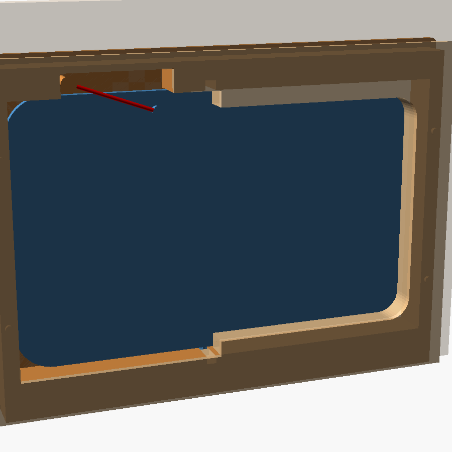
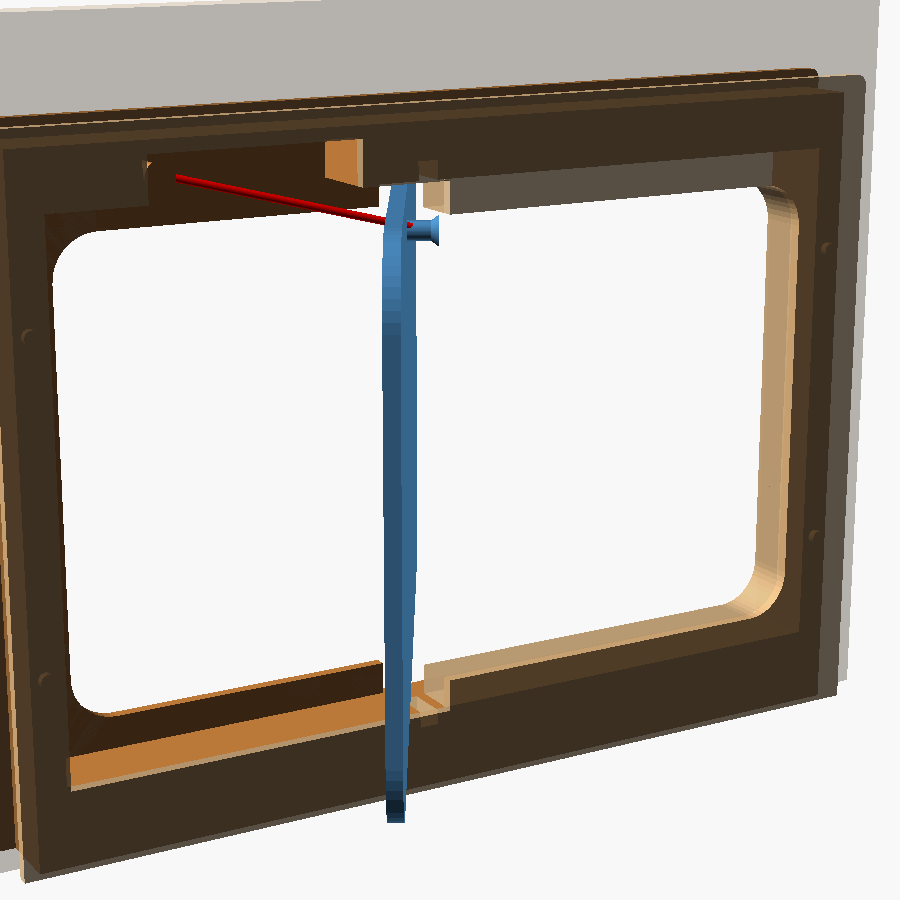
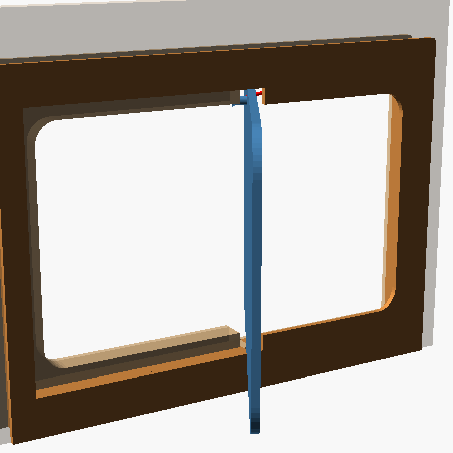
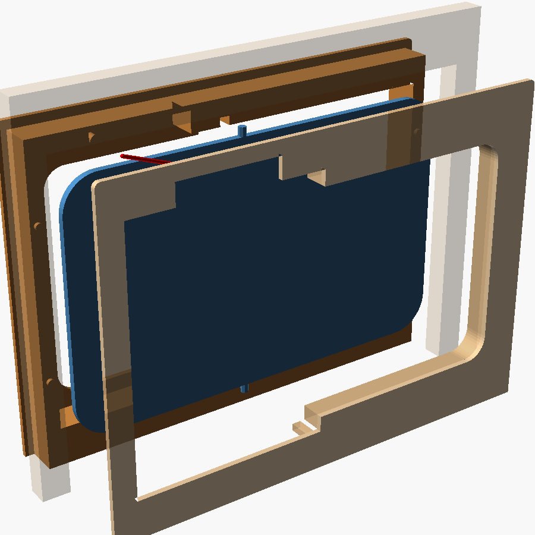

# B. Battant pivotant

Module imprimé de chatière à **battant pivotant sur un axe vertical**. Il se glisse dans la même encoche que le module de porte relevable du [concept A](../A-sas/) (côté gauche du caisson du sas, contreplaqué de 12 mm), à la place du volet 2. Trois pièces, sans vis.

  

Un battant rectangulaire aux coins arrondis (226 × 141 × 4 mm) tourne autour d'un axe vertical. L'ouverture fait 210 × 125 mm, juste assez haute pour un chat adulte (`ouv_h_r`).

**Pourquoi le chat passe toujours à droite.** Depuis le sas, le chat pousse la moitié droite (vue du sas) vers la pièce. Depuis la pièce, sa droite est l'autre moitié, qu'il pousse vers le sas. Dans les deux cas le battant tourne **dans le même sens**. On peut donc lui mettre des butées à recouvrement, comme une vraie porte :

- la moitié droite s'appuie sur la **peau du cadre, côté sas** (8 mm de recouvrement en haut, en bas et sur le côté) ;
- la moitié gauche s'appuie sur une **butée en U du couvercle, côté pièce**.

**Axe décalé, 55 / 45.** L'axe est 11 mm à droite du milieu (`part_gauche = 0.55`). Un coup de vent du dehors pousse tout le battant vers la pièce : sur la moitié droite, cela ouvre ; sur la moitié gauche, plus grande, cela appuie sur la butée. Le couple de fermeture est 1,5 fois le couple d'ouverture, donc le vent referme le battant au lieu de l'ouvrir. En contrepartie, le passage du chat qui sort du sas n'a que 89 mm de large ; l'autre en a 112.

Dans l'autre sens, le battant est bloqué. Du feutre de 1 mm sur les butées fait le joint ; il ne reste qu'une petite fuite le long de l'axe, en haut et en bas.

**Rappel.** Un élastique va d'un téton à l'arrière du battant (en haut, à 25 mm de l'axe) à un poteau caché dans une poche du cadre, au-dessus de l'ouverture à droite. Il passe de 47 mm fermé à 81 mm à 90°, et tient le battant sur ses butées au repos. Prendre un petit élastique d'environ 40 mm de long à plat, et doubler s'il ne referme pas franchement.

**Axe.** Deux tourillons octogonaux, de la même épaisseur que le battant, tournent dans des paliers du cadre ouverts vers l'arrière. Deux taquets du couvercle referment les paliers. Le battant repose sur le bout du tourillon du bas.

**Le couvercle** s'emboîte à force sur quatre tétons du cadre (jeu `serrage` = 0,15 mm à ajuster selon l'imprimante).

| Pièce | Impression |
|---|---|
| `cadre` | Face côté sas sur le plateau ; paliers, poche et tétons vers le haut. |
| `couvercle` | Face côté pièce sur le plateau ; butée et taquets vers le haut. |
| `battant` | À plat, face avant dessous ; les méplats des tourillons sont sur le plateau, le téton d'élastique vers le haut. |

Montage : poser le cadre face en dessous, déposer le battant (tourillons dans les paliers), accrocher l'élastique, emboîter le couvercle, glisser le module dans l'encoche.

À vérifier : que le chat accepte un passage de 89 mm de large, et qu'il garde bien sa droite. Si c'est trop étroit, rapprocher `part_gauche` de 0,5 (le vent referme alors moins fort).

## Maquette (`maquette/`, échelle 0,4)

- `planche.stl` : les trois pièces sur un plateau (216 × 156 mm) ; une STL par pièce.
- Buse de 0,4 mm, couches de 0,2 mm, PLA. Pas de feutre. Un élastique à cheveux ou d'orthodontie.
- Les STL ne sont pas dans git. Régénérer : `openscad -D echelle=0.4 -D 'part="planche"' -o maquette/planche.stl battant.scad`.

## Points à vérifier (non testé)

- **Poussée** : raccourcir ou doubler l'élastique pour régler.
- **Emboîtement du couvercle** : si les tétons sont trop serrés ou trop lâches, changer `serrage`.
- **Butées** : le battant doit être bloqué dans le mauvais sens et tourner librement de 0 à 90° dans le bon (vérifié sur le modèle aux deux échelles).

## Fichiers

* `battant.scad` : le module. Options : `echelle`, `angle` (aperçu ouvert), `coupe`, `part="eclate"`, `part_gauche`. La console affiche les cotes, les passages, l'élastique et le rapport des couples au vent.
* `apercu_ferme_piece.png`, `apercu_ouvert_piece.png`, `apercu_ouvert_sas.png`, `apercu_eclate.png`, `apercu_maquette.png`.
