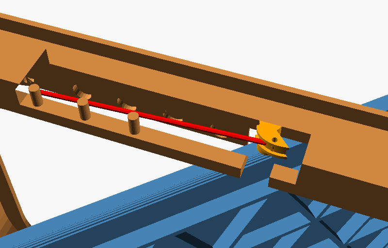
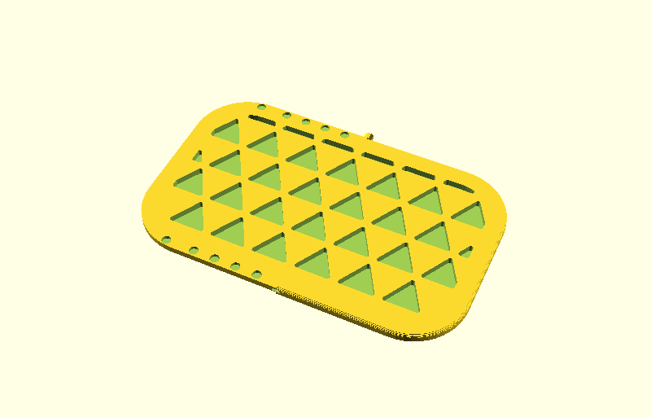
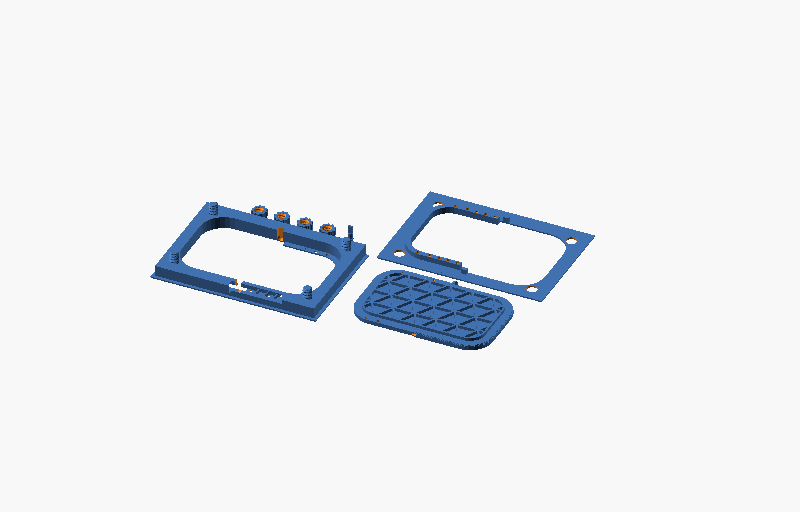

# B. Battant pivotant

Module imprimé de chatière à **battant pivotant sur un axe vertical**. Il se glisse dans la même encoche que le module de porte relevable du [concept A](../A-sas/) (côté gauche du caisson du sas, contreplaqué de 12 mm), à la place du volet 2. Pas de vis : le couvercle est serré par des molettes imprimées sur des tiges filetées imprimées avec le cadre.

  

Un battant de 226 × 141 × 6 mm aux coins bien arrondis (R 38) tourne autour d'un axe vertical, au milieu. L'ouverture fait 210 × 125 mm, juste assez haute pour un chat adulte (`ouv_h_r`). Le module fait 243 × 177 × 23,6 mm (253 × 182 avec les collerettes) ; encoche dans le contreplaqué : 244 × 178 mm depuis le bas.

**Arrondis.** L'ouverture (R 30), le battant (R 38) et la cavité où il tourne suivent le même arrondi (`r_coin_r` règle le tout). Le cadre et les collerettes restent des rectangles. Là où passe le chat, les bords sont arrondis en quart de rond. Les faces d'appui des butées restent plates pour le feutre.

**Pourquoi le chat passe toujours à droite.** Depuis le sas, le chat pousse la moitié droite (vue du sas) vers la pièce. Depuis la pièce, sa droite est l'autre moitié, qu'il pousse vers le sas. Dans les deux cas le battant tourne **dans le même sens**. On peut donc lui mettre des butées à recouvrement, comme une vraie porte :

- la moitié droite s'appuie sur la **peau du cadre, côté sas** (8 mm de recouvrement) ;
- la moitié gauche s'appuie sur une **butée en U du couvercle, côté pièce**.

Dans l'autre sens, le battant est bloqué. Du feutre de 1 mm sur les butées fait le joint.

**Axe centré.** Les deux passages font 98 mm de large. Le vent du dehors pousse autant sur les deux moitiés : il ne l'ouvre pas et ne le referme pas. On peut encore décaler l'axe (`part_gauche` > 0,5) pour que le vent le referme, au prix d'un passage plus étroit en sortant du sas.

## Fermeture : élastique sur came, puis aimants

**Rappel doux.** Un élastique tire le battant vers la position fermée. Il s'enroule sur une **came en spirale** posée en haut de l'axe. Plus la porte s'ouvre, plus l'élastique s'allonge, mais plus le rayon de la came diminue : le couple **baisse** au lieu de monter.

- Le profil est calculé pour que le couple à pleine ouverture soit `ratio_couple` (0,5) fois le couple porte fermée. Le rayon passe de 8,5 mm (fermé) à 5,2 mm (45°) puis à 3 mm (100°). L'élastique ne s'allonge que de 9 mm en plus de sa tension de repos (`pretension_r` = 20 mm).
- Avec un élastique de 0,1 N/mm, la poussée au milieu d'un passage serait d'environ 31 g fermé, 24 g à 45° et 16 g à 100°. Ce sont des ordres de grandeur : la raideur dépend de l'élastique.
- L'élastique est accroché d'un côté dans le trou de la came et de l'autre à l'un des **trois poteaux** de la chambre du haut, à 35, 50 ou 65 mm de l'axe. Plus le poteau est loin, plus l'élastique est tendu.
- **La came est une pièce à part** : la came, le tourillon rond du haut et un tenon en lame qui s'emboîte dans une mortaise du chant du battant. Pour changer la force, il suffit d'en réimprimer une avec un autre `came_r0_r`, `pretension_r` ou `ratio_couple`. La console vérifie qu'elle ne touche ni la peau côté sas (l'axe n'est qu'à 4 mm de l'intérieur de la peau), ni le couvercle, ni les poteaux.

**Verrou par aimants.** Le rappel ramène le battant presque fermé ; les aimants le tiennent fermé contre le vent. Des poches pour aimants disques Ø6 × 2 sont prévues en vis-à-vis dans la bande d'appui, en haut et en bas de chaque moitié, à **15, 30, 45, 60 et 80 mm** de l'axe :

- moitié droite (vue du sas) : dans la face avant du battant et dans la peau côté sas du cadre (il reste 0,8 mm de peau) ;
- moitié gauche : dans la face arrière du battant et dans la butée en U du couvercle.

On ne remplit qu'une paire ou deux, et on choisit la distance. Plus l'aimant est près de l'axe, plus le chat a de levier : pour un aimant qui tient avec 1 N, le chat doit pousser 0,27 N au milieu du passage s'il est à 15 mm, mais 1,4 N s'il est à 80 mm. Commencer près de l'axe et s'en éloigner si le battant ne tient pas. Coller les aimants (attention au sens : ils doivent s'attirer). Le feutre peut passer devant : il fait 1 mm d'entrefer.

**Ouverture maximale.** Vers 100°, la moitié qui s'ouvre vers la pièce bute sur le couvercle, près de l'axe. La came est calculée jusque-là (`angle_max`).

## Battant à triangles imprimés

Un grand panneau plat de 6 mm risque de se voiler avec le temps, et l'étanchéité en souffrirait. Le battant garde donc une **bande d'appui plate** tout autour (sans arrondi sur la face qui touche la butée : la face avant pour la moitié droite, la face arrière pour la gauche). Le battant reste une plaque plate de 6 mm. À l'intérieur de l'ouverture, des **triangles y sont imprimés en damier depuis chaque face** : les triangles pointe en haut sont creusés côté sas, les triangles pointe en bas côté pièce, sur 4,8 mm, avec 1,2 mm de fond. Il reste un **treillis triangulé dans l'épaisseur** (parois de 2 mm sur toute l'épaisseur, triangles de 30 mm), qui raidit dans toutes les directions et en torsion, avec un fond alterné sur chaque face. Les deux faces montrent le motif, et rien ne dépasse de la plaque : le battant passe partout où passait la plaque pleine. Il pèse 111 g au lieu de 237 g plein. Il est un peu moins raide qu'une plaque pleine de 6 mm, mais nettement plus raide pour son poids.

À l'impression, face côté sas dessous, le fond des triangles creusés par-dessous est un pont d'environ 26 mm, que les trancheurs font bien en PLA ou en PETG. Si c'est trop, baisser `nerv_maille_r`. Options : `nervures = false` (plaque pleine), `nerv_maille_r`, `nerv_fond_r`, et `nerv_h_r` (surépaisseur côté pièce dans l'ouverture si le battant manque de raideur, par exemple 5 mm pour une zone de 11 mm).

**Axe.** En bas, un tourillon octogonal du battant ; en haut, le tourillon rond de la came. Ils tournent dans des paliers du cadre ouverts vers l'arrière, que deux taquets du couvercle referment. Le battant repose sur le bout du tourillon du bas.

**Fixation.** Le cadre porte dans ses coins 4 tiges filetées imprimées (Ø 10, pas de 3 mm, filet arrondi imprimable sans support), qui traversent le couvercle et dépassent de 13 mm côté pièce. Quatre molettes imprimées (Ø 16 × 8, moletées et taraudées) se serrent à la main. À l'échelle 0,4 : tiges Ø 6 au pas de 2, molettes Ø 10 × 5.

| Pièce | Qté | Impression |
|---|---|---|
| `cadre` | 1 | Face côté sas sur le plateau ; paliers, chambre de la came, poteaux et tiges filetées vers le haut. |
| `couvercle` | 1 | Face côté pièce sur le plateau ; butée et taquets vers le haut. |
| `battant` | 1 | À plat, face côté sas dessous ; le fond des triangles creusés par-dessous est un pont. |
| `molette` | 4 | À plat, chanfrein d'entrée en bas. |
| `came` | 1 | Came sur le plateau, tenon vers le haut. |

Montage :

1. Coller les aimants dans les poches choisies, du battant et des butées, en vérifiant qu'ils s'attirent.
2. Enfoncer le tenon de la came dans la mortaise du haut du battant.
3. Poser le cadre face en dessous. Déposer le battant, tourillons dans les paliers, la came dans la chambre du haut.
4. Passer l'élastique dans le trou de la came et autour d'un poteau.
5. Poser le couvercle sur les tiges filetées et serrer les quatre molettes, puis glisser le module dans l'encoche, côté sas.
6. Le battant doit revenir doucement, puis se coller sur les aimants.

## Maquette (`maquette/`, échelle 0,4)

- `planche.stl` : toutes les pièces sur un plateau ; une STL par pièce.
- Buse de 0,4 mm, couches de 0,2 mm, PLA. Pas de feutre. Aimants Ø2 × 1 (la bande d'appui ne fait que 3,2 mm) ; les poches de la peau la traversent. Un élastique d'orthodontie. La came (rayon 3,2 mm) est surtout là pour voir le principe.
- Les STL ne sont pas dans git. Régénérer : `openscad -D echelle=0.4 -D 'part="planche"' -o maquette/planche.stl battant.scad`.

## Points à vérifier (non testé)

- **Rappel** : choisir l'élastique et le poteau. Si le battant ne revient pas jusqu'aux aimants, reculer d'un poteau ou réimprimer une came plus grande ou moins dégressive (`ratio_couple` plus près de 1).
- **Aimants** : leur force n'est pas connue ; commencer à 15 mm de l'axe.
- **Triangles imprimés** : vérifier la qualité des ponts au fond des triangles creusés côté sas.
- **Molettes** : le filet a 0,35 mm de jeu (`jeu_f`) ; l'augmenter si elles serrent trop.
- **Butées** : le battant doit être bloqué dans le mauvais sens et tourner librement de 0 à 90° dans le bon (vérifié sur le modèle aux deux échelles).

## Fichiers

* `battant.scad` : le module. Options : `echelle`, `angle` (angle d'ouverture du battant dans l'aperçu, de -5 à 90°), `coupe`, `part` (`assembled`, `eclate`, une pièce, `planche`), `part_gauche`, la came (`came_r0_r`, `pretension_r`, `ratio_couple`, `poteau`, `k_elast`), les aimants (`aim_d_r`, `aim_e_r`, `aim_dist_r`), les triangles imprimés (`nervures`, `nerv_maille_r`, `nerv_fond_r`, `nerv_h_r`), et pour la conception `arrondis = false` (sans arrondis des bords) et `rapide = true` (sans arrondis, filets lisses, moins de facettes ; pas pour imprimer). La console affiche les cotes, les passages, le profil de la came, les poussées et les leviers des aimants.
* `apercu_ferme_piece.png`, `apercu_ouvert_piece.png`, `apercu_ouvert_sas.png`, `apercu_eclate.png`, `apercu_came.png`, `apercu_battant.png`, `apercu_maquette.png`.
