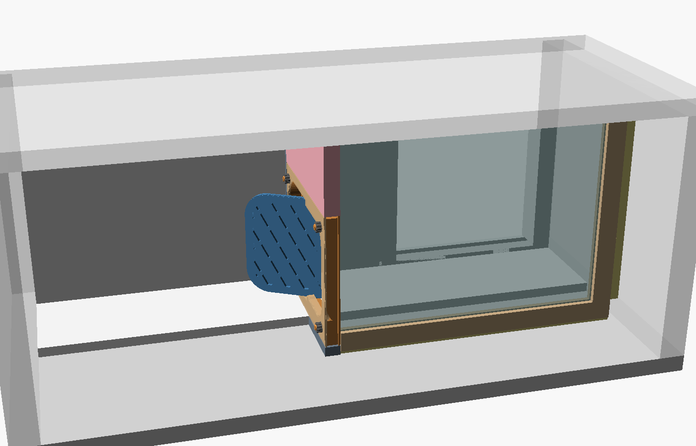

# Chatière d'hiver — concept C : « mur en L » (le sas dans l'embrasure)

## Idée

- **Parcours du chat** (vu de la pièce) :
  - la partie **gauche de l'embrasure reste libre** : le chat monte sur l'appui à gauche, face à la fenêtre ;
  - en tournant à droite, il fait face à une **paroi perpendiculaire à la fenêtre**, qui porte le premier **module B** (battant pivotant, [../B-battant](../B-battant/)) ;
  - derrière cette paroi, le **sas** occupe la partie droite de l'embrasure ;
  - le deuxième **module B** se loge dans la fenêtre, à la place de la chatière d'été (250 × 290, maintenant dans [../../chatiere_ete](../../chatiere_ete/)), et tient par lui-même.
- **Tout est poussé contre la fenêtre** : la paroi va de la fenêtre jusqu'à 54 mm du bord de l'appui, et le verre est au ras de son avant. L'avant de l'appui reste libre.
- **Seuls les deux modules B et le chapeau de fenêtre sont imprimés.** Le reste est en mousse et en bois :
  - **Paroi, d'une seule largeur (253)** : le module B intérieur posé sur la marche du fond (154 de profondeur, avec une cale de 15 sous l'avant). Au-dessus, un **bloc de mousse rigide** (XPS 1 po, à peu près l'épaisseur du module, 23,6) jusqu'au plafond. On le coupe une fois le module imprimé et posé, à la hauteur mesurée plus 3 mm. Il entre en force, étanche, et tient le module. Le décrochage du plafond se fait au cutter. Si le module bouge quand même, on ajoutera un petit sabot imprimé qui coiffe son dessus et reçoit le bloc.
  - **Façade** : la **vitre 413 × 308 × 2,5** non coupée. Son bord gauche bute contre la paroi. Les trois autres côtés sont pris dans un **cadre en bois** (lattes de 30 × 19) :
    - **rainure du verre** de 4 × 10 au milieu du chant intérieur : le verre entre de 8, avec un joint mousse adhésif ou un cordon de silicone ;
    - **rainure de mousse** de 13 × 8 sur le chant extérieur, pour une bande de mousse rigide de ½ po coupée sur place (contre l'appui, le mur de droite et le plafond) ;
    - le **montant** se colle et se visse entre les deux traverses ;
    - prévoir un vernis ou une peinture : le sous-sol est humide.
  - **Fenêtre** : le module B extérieur, allongé de 45 mm vers le bas (`socle_r`), pose au fond de la gouttière (40 de large, 17 sous l'ouverture). Son seuil est 58 au-dessus du bas de l'ouverture de 276. Au-dessus, un **chapeau de fenêtre** imprimé a une languette de 11 × 4 qui entre dans la fente du haut (15 × 10).
- **Sans vis dans le mur** : tout tient par la mousse.

## Pièces (embrasure de 884 × 372 × 315, mesurée)

Ouverture des battants : 210 × 150.

| Pièce | Nombre | Taille | Fabrication |
|---|---|---|---|
| Module B de la paroi | 1 | 253 × 207 | `../B-battant/battant.scad` |
| Module B de la fenêtre | 1 | 253 × 252 | `battant.scad -D socle_r=45`, en PETG |
| Chapeau de fenêtre (`vue="chapeau_fenetre"`) | 1 | 253 × 35 | imprimé à plat, en PETG |
| Traverses (bas, haut) | 2 | 435,6 × 30 × 19 | bois, rainure du verre et rainure de mousse |
| Montant droit | 1 | 292 × 30 × 19 | bois, idem |
| Bloc au-dessus de la paroi | 1 | 253 × 23,6, environ 153 devant et 146 au fond | XPS 1 po, coupé sur place |
| Bandes de mousse rigide ½ po | 3 | 13 (bas), 23 (droite), 23 (haut) de large | coupées sur place |
| Mousse souple | | | entre la paroi et la fenêtre, cale de 15 sous l'avant de la paroi |

## Montage

1. **Fenêtre** : poser le module dans la gouttière (face côté sas vers le dehors), le caler, refermer la fenêtre dessus. Glisser la languette du chapeau dans la fente du haut, le soulever de 5, puis le laisser descendre sur les collerettes.
2. **Paroi** : poser le module sur la marche avec sa cale et la mousse souple côté fenêtre. Mesurer jusqu'au plafond, devant et au fond. Couper le bloc 3 mm plus haut et l'enfoncer.
3. **Façade** :
   1. poser la traverse basse sur sa bande de mousse, contre la paroi ;
   2. poser le verre dans la rainure (arêtes poncées, joint en place) ;
   3. visser le montant sur la traverse basse, puis la traverse haute sur le montant et le verre ;
   4. coincer les bandes de mousse rigide à droite, puis en haut.

## À mesurer

- La hauteur de la **marche** (`rebord_hh`, 15 supposés) et le décrochage du haut.
- Le fond de la gouttière par rapport à l'appui (`fen_zf`), sa position (`fen_y`), et le décalage de la fente du haut.
- La section réelle des lattes (`cad_l`, `cad_e`) et l'épaisseur de la mousse rigide (`rig_e`).

## Fichier

`mur.scad` inclut `../B-battant/battant.scad` et reprend ses cotes. Il sert surtout à vérifier l'implantation et à sortir les cotes de débit (dans la console). Les options sont :

- `vue` (`assemble`, `eclate`, `chapeau_fenetre`) et `angle` (les deux battants) ;
- l'embrasure et la marche (`rebord_prof`, `rebord_hh`, `haut_fen`), la fenêtre (`fen_*`, `socle_f`), le cadre en bois (`cad_l`, `cad_e`, `rain_*`, `rig_*`, `g_b`, `g_d`) et la mousse (`mousse_c`, `bloc_comp`).

Rendre avec le moteur Manifold : environ une seconde.
