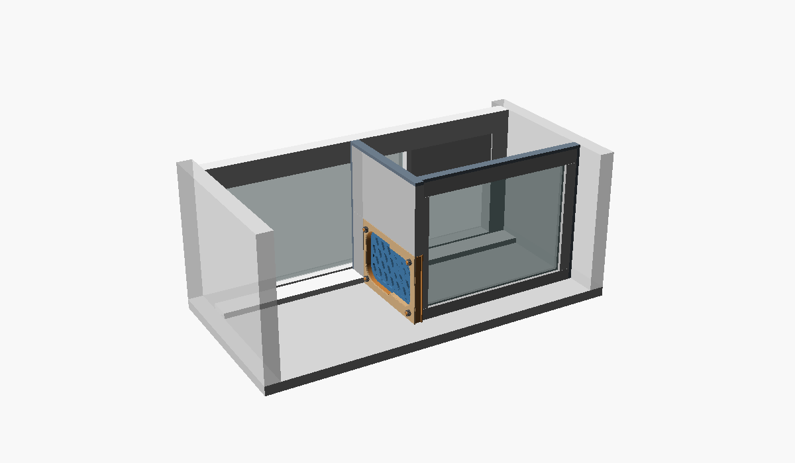
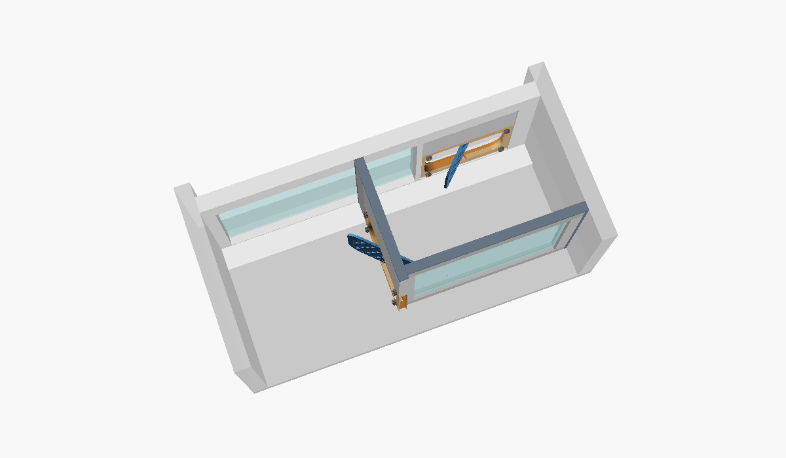
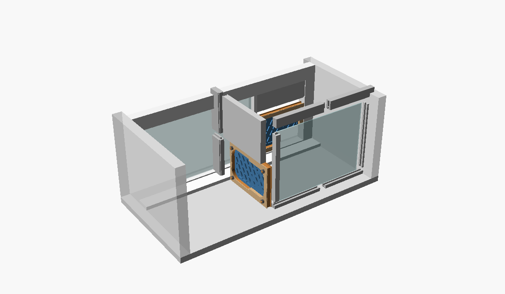

# Chatière d'hiver — concept C : « mur en L » (le sas dans l'embrasure)

## Idée

- **Parcours du chat** (vu de la pièce) :
  - la partie **gauche de l'embrasure reste libre** : le chat monte sur l'appui à gauche, face à la fenêtre ;
  - en tournant à droite, il fait face à une **paroi perpendiculaire à la fenêtre**, qui porte le premier **module B** (battant pivotant, [../B-battant](../B-battant/)) ;
  - derrière cette paroi, le **sas** occupe la partie droite de l'embrasure ;
  - le deuxième **module B** se loge dans la fenêtre, à la place de la chatière d'été (250 × 290, maintenant dans [../../chatiere_ete](../../chatiere_ete/)), et tient par lui-même.
- **Les trois éléments** :
  - **Paroi** : le module B est posé sur l'appui, avec un **chapeau** imprimé au-dessus jusqu'en haut de l'embrasure (368 mm, plus que le plateau de 260). Une **bande** en deux morceaux va du module à la fenêtre et repose sur le rebord PVC. Le module dépasse de 9 mm du bord de l'appui pour ne pas toucher ce rebord (60 mm de profondeur).
  - **Façade** côté pièce, de la paroi au mur de droite : la **vitre 411 × 309** non coupée, entre deux montants et deux traverses imprimés. On voit le chat dans le sas.
  - **Fenêtre** : le module B a le corps de 243 de large dans l'emplacement de 250, et un **chapeau de fenêtre** au-dessus.
- **Sans vis** :
  - de la mousse (15 mm au repos, environ 8 comprimée) contre le mur de droite, le haut de l'embrasure et la fenêtre ; on glisse les pièces, la mousse se comprime, et tout tient par friction ;
  - la façade s'appuie sur la face côté sas de la paroi ;
  - les pièces s'emboîtent par languettes et rainures, et les **âmes** du chapeau et de la bande glissent entre les collerettes du module, comme le contreplaqué du concept B.

## Pièces (embrasure supposée de 860 de large)

Toutes les pièces font 23,6 mm d'épaisseur, comme le module B, et s'impriment à plat. 15 % de remplissage suffisent.

| Pièce (`vue`) | Nombre | Taille | Note |
|---|---|---|---|
| Module B | 2 | 253 × 182 | `../B-battant/battant.scad` : paroi et fenêtre |
| `chapeau` | 1 | 253 × 182 | au-dessus du module de la paroi |
| `bande_bas`, `bande_haut` | 2 | 58 × 174 et 58 × 177 | entre le module et la fenêtre |
| `traverse_bas` (`piece` = 0, 1) | 2 | 232 × 30 | sur l'appui ; rainure de la vitre dessus |
| `traverse_haut` (`piece` = 0, 1) | 2 | 232 × 37 | rainure de la vitre dessous |
| `montant_g`, `montant_d` | 2 | 309 × 20 et 309 × 30 | **en diagonale** sur le plateau |
| `chapeau_fenetre` | 1 | 250 × 112 | au-dessus du module de la fenêtre |
| Mousse | env. 2 m | 15 × 24 | |

## Montage

1. Fenêtre : retirer la chatière d'été et poser le module B dans l'emplacement, la face côté sas vers le dehors. Ajouter le chapeau de fenêtre.
2. Paroi : poser le module B sur l'appui, puis le chapeau dessus. Glisser la bande du bas sur le rebord PVC, son âme entre les collerettes du module, puis la bande du haut. Mettre la mousse contre la fenêtre et en haut.
3. Façade : poser les traverses basses, les montants, la vitre (ruban mousse de 3 mm dans les rainures), puis les traverses hautes. Pousser la mousse entre le montant droit et le mur, puis celle du haut.

Contrôlé : les pièces ne se chevauchent pas, et les deux battants tournent de 0 à 100° sans rien toucher (paroi, façade, vitre, rebord). Bloqués à −3°, comme prévu.

## À mesurer

- `embr_l` : la largeur de l'embrasure (860 supposés). La paroi se place d'elle-même : la façade fait 445 mm, le reste est le passage libre (383 mm avec 860).
- L'emplacement de la chatière d'été : `fen_x0` (bord gauche vu de la pièce), `fen_z0`, `fen_y`, et l'épaisseur du cadre de la fenêtre autour. Les collerettes du module le prennent en sandwich s'il fait moins de 17,6 mm.
- `rebord_prof`, `rebord_hh`, `verre_e`.

## Fichier

`mur.scad` inclut `../B-battant/battant.scad` et reprend ses cotes. Les options sont :

- `vue` (`assemble`, `eclate`, une pièce), `piece`, et `angle` (les deux battants) ;
- l'embrasure, la fenêtre, la mousse, la vitre et la façade (`mont_d` règle la place de la paroi).

Rendre avec le moteur Manifold : moins d'une seconde.
