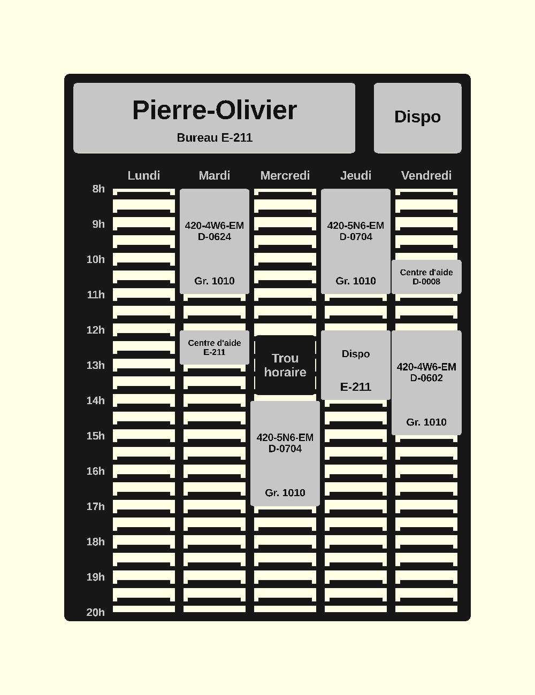
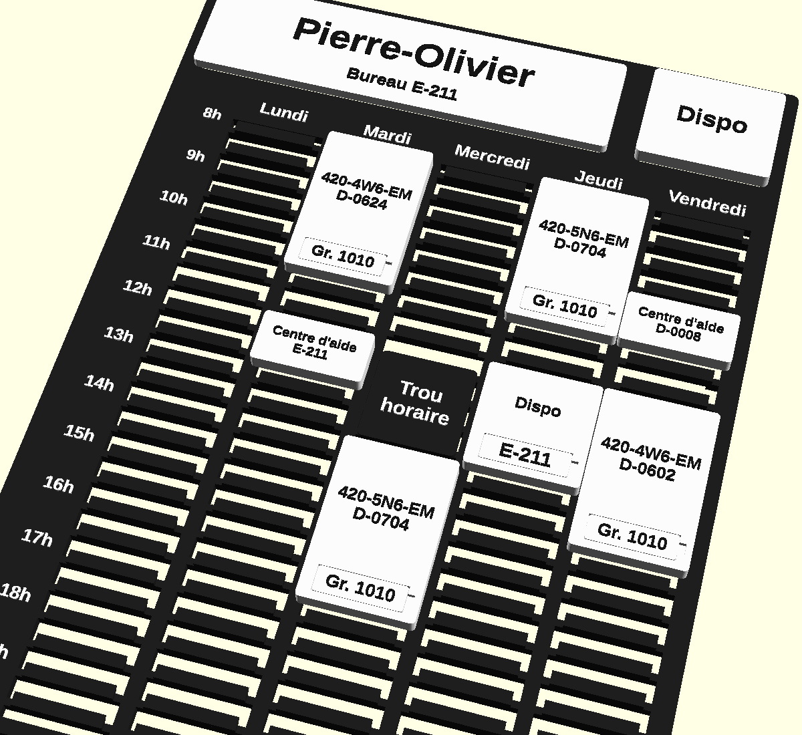
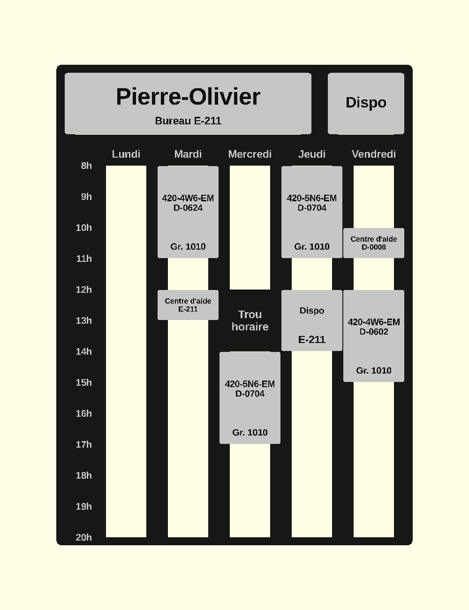

# Horaire modulaire pour porte de bureau

Un horaire modulaire à fixer sur la porte du bureau : une base **noir mat**
avec la grille de la semaine (lundi → vendredi, 8h → 20h), des **blocs de
cours blancs** au texte noir qu'on accroche dans la grille, une **plaque nom**
et une **plaque de statut** interchangeable (« Dispo », « Absent », « De
retour dans 5 minutes », « Au local … »).

Tout est paramétrique (OpenSCAD). Seulement **deux filaments** : noir mat et
blanc.





## Fichiers

| Fichier | Rôle |
|---|---|
| `horaire_lego.scad` | Bibliothèque : tous les paramètres et toutes les pièces. Ne dessine rien seul. |
| `horaire.scad` | **Gabarit** à copier pour chaque prof (nom + liste des blocs). |
| `exemple_pierre-olivier.scad` | Exemple réel, relevé dans l'horaire de Pierre-Olivier (automne 2026). |
| `test_ajustement.scad` | Coupon de réglage des jeux. **À imprimer en premier.** |

## Fixation : tasseaux (par défaut) ou plots

`fixation = "tasseau"` — le principe du **tasseau français** (*french
cleat*), en miniature. Chaque demi-heure de la base porte une petite lèvre
horizontale dont le dessus est taillé à 45° (queue d'aronde). Le dos de
chaque pièce a une rainure assortie par demi-heure :

```
      porte │ base │ lèvre        pièce
            │      │ ╱‾‾╲  ←── la rainure de la pièce coiffe la lèvre ;
            │      │╱    │     le poids tire la pièce vers la porte
```

1. présenter la pièce **2 mm plus haut** que sa place ;
2. la plaquer contre la base ;
3. la laisser **descendre** : elle s'accroche et ne bouge plus.

Pour la retirer : la soulever de 2 mm et la tirer. Rien à forcer, rien qui
s'use, et la porte peut claquer. La lèvre est plus courte que la pièce
(`tas_retrait`), donc chaque bloc est aussi centré dans sa journée.

⚠️ Deux blocs collés l'un au-dessus de l'autre dans la même journée : on
retire d'abord celui du haut (il faut 2 mm de jeu au-dessus d'un bloc pour
le soulever). La bosse « Trou horaire » est en retrait de 3 mm exprès pour
laisser soulever le bloc qui la suit.

`fixation = "pions"` — **variante plus épurée** : même accroche à 45°, mais
au lieu d'une lèvre sur toute la largeur, **deux petits crochets de 4 mm**
par demi-heure, un de chaque côté de la journée, portés par les montants.
En base grille, il n'y a plus de traverses : chaque journée est une colonne
vide encadrée de deux montants, les jours se lisent beaucoup mieux (et la
base utilise encore moins de plastique). Le dos des blocs a deux courtes
rainures par demi-heure, qui centrent aussi le bloc dans sa journée. La
case du trou horaire reste pleine sous la bosse.



`fixation = "plots"` — plots Ø 5 mm et douilles (géométrie originale, pas
LEGO), `plots_cols = [1, 2]` = une paire de plots par demi-heure.

## Base : grille ajourée (par défaut) ou pleine

`base_style = "grille"` — la base n'est plus une plaque : un **cadre**, la
colonne des heures et la bande des jours en plein (pour le texte), des
**montants** entre les journées, et **une traverse par demi-heure** qui porte
la lèvre. Les pièces sont tenues aux bons endroits et l'on économise une
bonne partie du plastique et du temps d'impression de la base.

`base_style = "pleine"` — une plaque de 4 mm, avec traits gravés à chaque
heure et entre les jours.

## La grille

- 1 rangée = **30 minutes** (pas de 10 mm). Un bloc de 2 h fait 4 rangées,
  2 h 30 en fait 5, 3 h en fait 6.
- 1 journée = 40 mm de large.
- Heures en relief à gauche (8h … 20h), noms des jours en relief.
- **Mercredi 12h–14h : « Trou horaire »** commun à tous les profs : une simple
  **bosse de 2 mm** (`trou_bosse`) moulée dans la base, avec le texte ; pas
  de fixation à cet endroit.
- Zone tête : la **plaque nom** (16 × 4 pas) et la **plaque de statut**
  (5 × 4 pas).

Dimensions de la base : **230 × 310 mm** → coupée en **2 tuiles**
(230 × 175 et 230 × 135 mm) pour le Kobra X. La coupe passe toujours sur une
demi-heure, jamais au travers d'une étiquette d'heure ni du trou horaire.
Les tuiles sont réunies au dos par une **éclisse** (bande de 1,6 mm) logée à
fleur dans une poche, avec des ergots dans la colonne des heures et dans les
montants — à coller (cyano ou colle PLA).

## Les pièces (`part = …`)

| `part` | Pièce | Remarques |
|---|---|---|
| `assemblage` | Aperçu complet | pour vérifier, pas pour imprimer |
| `tuile` (+ `tuile = 0/1`) | Une tuile de la base | 0 = bas, 1 = haut |
| `base` | Base entière non coupée | si votre plateau est assez grand |
| `eclisse` | Bande de jonction des tuiles | 1 par coupe |
| `bloc` (+ `index`) | Le bloc n° `index` de la liste `horaire` | |
| `blocs` | Tous les blocs de l'horaire, à plat | 4 par rangée |
| `plaquettes` | Toutes les plaquettes (groupes, locaux) | |
| `plaque_nom` | Plaque nom (`nom`, `sous_titre`) | |
| `statut` (+ `index` 0..3) | Une plaque de statut | 0 Dispo, 1 Absent, 2 De retour…, 3 Au local |
| `statuts` | Les 4 plaques de statut, à plat | |
| `module` | Bloc libre : `duree`, `lignes`, `plaq` | ex. un 2 h 30 de rechange |
| `dispo` | Plaque « Dispo » libre (`duree`, `plaq` = local) | |
| `plaquette` | Une plaquette (`plaq`) | groupe ou local |

### Statut

Les plaques de statut s'accrochent en haut à droite, comme les blocs : on
retire l'une, on met l'autre. Les plaques inutilisées peuvent se ranger sur
une rangée libre de la grille. La plaque « Au local » a une poche pour une
plaquette amovible (`local_statut`), donc un seul « Au local » suffit pour
plusieurs salles. Les textes sont dans `statuts` (liste de lignes par
plaque) : on peut en ajouter (« En réunion », « En cours »…).

### Décrire un horaire

Dans votre copie de `horaire.scad` :

```openscad
nom          = "Pierre-Olivier";
sous_titre   = "Bureau E-211";
local_statut = "E-211";

// [jour, début, durée, lignes de texte, plaquette, couleur d'aperçu]
horaire = [
    [MAR,  8, 3,   ["420-4W6-EM", "D-0624"], "Gr. 1010", "MidnightBlue"],
    [MER, 14, 2.5, ["420-5N6-EM"],           "Gr. 1010", "DarkGoldenrod"],
    [JEU, 12, 2,   ["Dispo"],                "E-211",    "Sienna"],
];
```

- `jour` : `LUN MAR MER JEU VEN` ; `début` et `durée` en multiples de 0,5 h.
- `lignes` : textes en relief sur le bloc (n° de cours, local…), ajustés
  automatiquement à la largeur.
- `plaquette` : texte d'une **plaquette amovible** qui s'enclenche dans une
  poche du bloc (avec encoche pour l'ongle) — pratique pour changer le groupe
  d'une session à l'autre sans réimprimer le bloc. Avec
  `groupe_mode = "texte"`, ou si le bloc est trop court (1 h), le texte est
  simplement mis en relief sur le bloc.
- La couleur d'aperçu n'est utilisée que si `couleurs_par_cours = true` ;
  par défaut l'aperçu montre le rendu noir / blanc imprimé.
- La console d'OpenSCAD signale les blocs hors plage, qui se chevauchent ou
  qui tombent sur le trou horaire.

## L'exemple réel (Pierre-Olivier) — est-ce que tout rentre ?

| Activité | Horaire réel | Bloc | Rentre ? |
|---|---|---|---|
| 420-4W6-EM gr. 1010 (D-0624) | mar. 08:00–11:00 | 3 h | ✅ exact |
| Centre d'aide (E-211) | mar. 12:00–12:45 | 1 h | ⚠️ arrondi à la demi-heure supérieure |
| Réunion de département | mer. 12:00–14:00 | — | ✅ c'est le « Trou horaire » moulé |
| 420-5N6-EM gr. 1010 (D-0704) | mer. 14:00–17:00 | 3 h | ✅ exact |
| 420-5N6-EM gr. 1010 (D-0704) | jeu. 08:00–11:00 | 3 h | ✅ exact |
| Disponibilité (E-211) | jeu. 12:00–13:45 | Dispo 2 h | ⚠️ arrondi |
| Centre d'aide (D-0008) | ven. 10:00–11:00 | 1 h | ✅ exact |
| 420-4W6-EM gr. 1010 (D-0602) | ven. 12:00–15:00 | 3 h | ✅ exact |

Tous les cours (3 h) et les blocs de 2 h / 2 h 30 tombent sur la grille de
demi-heure. Seules les activités de 45 min / 1 h 45 doivent être arrondies.
Un bloc de 3 h fait 59,6 × 39,6 mm, assez pour deux lignes de texte et la
poche de plaquette ; un bloc de 1 h (19,6 mm) a juste la place pour deux
lignes de texte, sans poche.

## Impression (Anycubic Kobra X, PLA)

**Ordre conseillé :** 1) `test_ajustement.scad` → régler les jeux ;
2) tuiles et éclisse (noir mat) ; 3) blocs, plaque nom, statuts, plaquettes
(blanc).

### Réglages généraux

- Buse 0,4 mm, couches de **0,2 mm**.
- 3 périmètres, remplissage 15–20 %. **Aucun support** nécessaire.
- Toutes les pièces sont déjà orientées pour l'impression (face texte vers le
  haut, dos sur le plateau).

| Pièce | Orientation | Remarque |
|---|---|---|
| Tuiles | à plat, lèvres vers le haut | le dessous des lèvres est à 45° : pas de support ; en grille, la bosse du trou horaire fait des ponts de ~7 mm entre traverses |
| Blocs, plaque nom, statuts | dos sur le plateau | les rainures s'élargissent en montant (45°) puis se ferment par un pont de ~8 mm |
| Plaquettes | à plat | minuscules : bordure (brim) facultative |

### Texte en couleur (changement de filament par pause)

Les textes sont en relief de **0,6 mm**. Dans le trancheur (Anycubic Slicer
Next / Orca / Cura), ajouter une **pause / changement de filament (M600)** à
la hauteur indiquée. Les valeurs exactes s'affichent dans la console
d'OpenSCAD (`ECHO: Pauses couleur …`). Avec les valeurs par défaut :

| Pièce | Corps | Pause(s) à Z = | Texte |
|---|---|---|---|
| Blocs, statuts | blanc | **6,0 mm** | noir |
| Plaque nom | blanc | **4,0 mm** | noir |
| Plaquettes | blanc | **1,6 mm** | noir |
| Base | noir mat | **4,0 mm** → blanc, **4,6 mm** → noir, **6,0 mm** → blanc | heures, jours et « Trou horaire » en blanc |

Sur la base, le pied des lèvres (0,6 mm) passe aussi en blanc — invisible
une fois les blocs posés. Version plus simple : base tout en noir sans pause
(le relief se lit quand même), ou une seule pause à 6 mm pour le texte du
trou horaire.

### Réglage des jeux (`test_ajustement.scad`)

| Paramètre | Défaut | Rôle | Si trop serré | Si trop lâche |
|---|---|---|---|---|
| `jeu_tasseau` | 0,30 | jeu lèvre / rainure | augmenter | diminuer |
| `jeu_plot` | 0,10 | (plots) jeu diamétral douille / plot | augmenter | diminuer |
| `jeu_poche` | 0,15 / côté | plaquette dans sa poche | augmenter | diminuer |
| `eclisse_jeu` | 0,3 | éclisse dans sa poche | augmenter | diminuer |

En mode tasseau ou pions, le coupon est un bout de base (1 journée × 2 h, dans le
style `base_style`) et 4 blocs d'une heure marqués `15 25 35 45` (jeu en
centièmes de mm) ; en mode plots, une base 4 × 2 plots et 5 blocs. Plus une
poche + plaquette. Reporter les valeurs retenues dans votre `horaire.scad`
(après la ligne `include`).

## Montage

1. Poser les deux tuiles face contre table, coller l'éclisse dans les poches
   (ergots dans les trous). Laisser sécher à plat.
2. Fixer sur la porte avec du ruban double face (bandes type Command™ ou
   VHB) au dos — sur le cadre, la colonne des heures et les montants en
   mode grille.
3. Accrocher la plaque nom, la plaque de statut et les blocs.

## Paramètres principaux (dans `horaire_lego.scad`)

- Fixation : `fixation` (`"tasseau"` / `"pions"` / `"plots"`), `tas_t`, `tas_h`,
  `jeu_tasseau`, `tas_retrait` ; pions : `pion_l`, `pion_marge`, `pion_appui` ; plots : `plot_d`, `plot_h`, `jeu_plot`,
  `plots_cols`.
- Base : `base_style` (`"grille"` / `"pleine"`), `base_e`, `montant_l`.
- Grille : `pas` (10), `jour_l` (4), `heure_debut`/`heure_fin` (8/20),
  `jours`.
- Trou horaire : `trou_actif`, `trou_jour` (`MER`), `trou_debut` (12),
  `trou_duree` (2), `trou_bosse` (2), `trou_retrait` (3), `trou_texte`.
- Statuts : `statuts`, `statut_local`, `local_statut`, `statut_affiche`
  (aperçu).
- Couleurs d'aperçu : `couleur_base`, `couleur_bloc`, `couleur_texte_bloc`,
  `couleurs_par_cours`.
- Impression : `lit` (250) — la base est recoupée automatiquement en autant
  de tuiles que nécessaire ; `texte_h` (relief), `police`.

Pour redéfinir un paramètre, l'écrire **après** `include <horaire_lego.scad>`
dans votre fichier : OpenSCAD retient la dernière valeur.

Testé avec OpenSCAD 2021.01.
